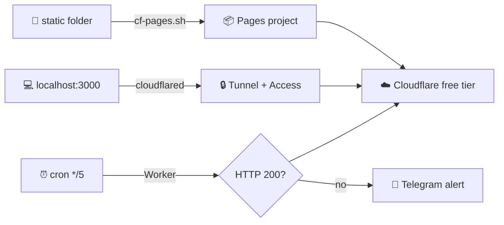

<div align="center">

# ☁️ AgentMujoCloudflareTools

### Free Cloudflare workflows for OpenCode AI agents

Deploy static sites • Expose local services safely • Monitor uptime — all on the free tier.

[](LICENSE)
[](https://pages.cloudflare.com/)
[](https://workers.cloudflare.com/)
[](https://www.cloudflare.com/zero-trust/)


</div>

---

## 🧰 &nbsp;What is inside

| # | Workflow | One-liner | Cost |
|---|----------|-----------|------|
| 1 | 📦 **pages-deploy** | Static folder → `https://NAME.pages.dev` | ✅ Free, unlimited sites |
| 2 | 🔒 **tunnel-expose** | `localhost:PORT` → safe public URL, zero open ports | ✅ Free + Access up to 50 users |
| 3 | 💓 **workers-cron-health** | Scheduled Worker pings your URLs, alerts on Telegram | ✅ Free (Workers 100k req/day) |



<details>
<summary><b>📦 1. pages-deploy — details</b></summary>
<br>

**Decide first:** want a `*.pages.dev` domain → this workflow (Wrangler). A new Worker app or `*.workers.dev` is fine → `cf deploy &lt;dir&gt;` instead (the `cf` CLI has no legacy Pages upload).

- ♾️ Unlimited sites & requests · 📄 25 MB max per file
- First run creates the project, later runs just deploy
- Convention: `<site>-staging` for previews, `<site>` for production
- Cleanup: `wrangler pages project delete <project-name>`

</details>

<details>
<summary><b>🔒 2. tunnel-expose — details</b></summary>
<br>

Never expose dev servers with bare `python3 -m http.server` or direct ports.

- ⚡ **Quick:** `cloudflared tunnel --url http://localhost:PORT` → random `*.trycloudflare.com` URL (dies with the command)
- 🏠 **Named:** `cloudflared tunnel create <name>` → `route dns` → `tunnel run` (systemd for persistence)
- 🛡️ **Lock it:** Cloudflare Access in front (free ≤ 50 users), then verify the raw `IP:port` is unreachable

</details>

<details>
<summary><b>💓 3. workers-cron-health — details</b></summary>
<br>

Scheduled Worker (`*/5 * * * *`) fetches each target URL, sends a Telegram message on non-200. Secrets via `wrangler secret put`, logs via `wrangler tail`. Full template lives in the skill (`SKILL.md`).

</details>

---

## 🚀 &nbsp;Install (any OpenCode, 1 minute)

```bash
git clone https://github.com/xnet-ba/agentmujo-cloudflare-tools.git
cd agentmujo-cloudflare-tools
./install.sh --check   # preflight, optional
./install.sh           # skill + cf-pages.sh, idempotent (safe to re-run)
```

> 📋 Needs: `node` · `npx` · `git` — wrangler runs via `npx -y wrangler`, no global install.

## 🔑 &nbsp;Auth (yours, never in this repo)

```bash
export CLOUDFLARE_API_TOKEN="<token>"        # dash → My Profile → API Tokens
export CLOUDFLARE_ACCOUNT_ID="<account-id>"  # 32 hex chars, dashboard sidebar
```

| Workflow | Token scope needed |
|----------|--------------------|
| pages-deploy | Account · Cloudflare Pages · **Edit** |
| tunnel-expose | Account · Argo Tunnel · **Edit** |
| workers-cron-health | Account · Workers Scripts · **Edit** |

```bash
cf-pages.sh <dir> <project-name>   # → https://<project-name>.pages.dev 🎉
./uninstall.sh                     # removes skill + script only; Cloudflare projects untouched
```

## 📁 &nbsp;Layout

```
skills/agentmujo-cloudflare-tools/SKILL.md  # 🤖 the skill — 3 agent workflows
scripts/cf-pages.sh                          # 🛠️  pages.dev deploy helper
install.sh / uninstall.sh                    # ⚙️  idempotent installer
```

---

<div align="center">

MIT © 2026 AgentMujo · K.PRO Lab 🧪 · No secrets inside — verified by fresh-clone scan on every release

</div>
